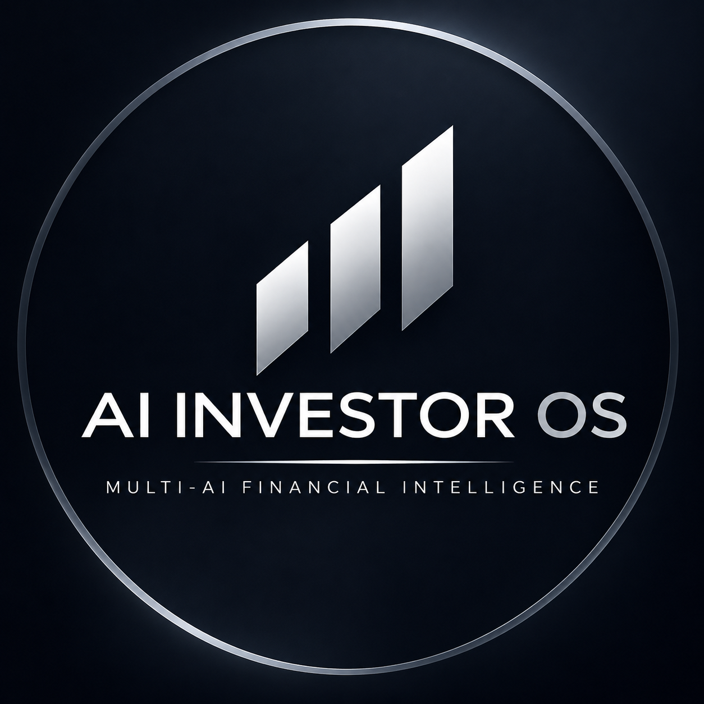
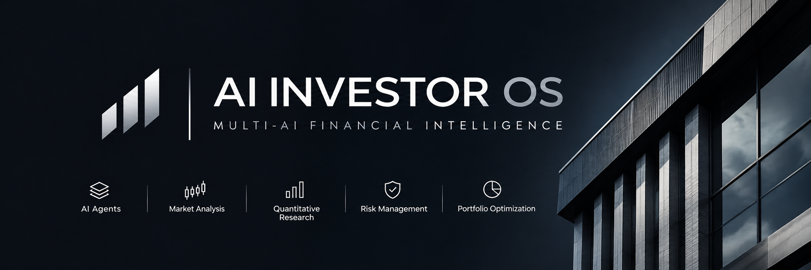

  

  

AI INVESTOR OS

The Open Intelligence Platform for Financial Markets

AI INVESTOR OS is an open-source project exploring the intersection of artificial intelligence, financial research and quantitative analysis.

Our vision is to build a modular multi-agent platform where multiple AI models collaborate to analyze financial markets, evaluate investment opportunities, challenge assumptions and generate structured financial insights.

The goal is to make advanced AI-powered financial research more accessible, transparent and extensible.

⸻

Vision

Traditional financial research often requires multiple tools, data sources and specialized expertise.

AI INVESTOR OS explores a different approach: bringing together specialized AI agents, financial datasets and quantitative tools in one unified environment.

Rather than relying on a single AI model, the platform aims to coordinate multiple models with different analytical perspectives.

Core Concepts

Multi-AI Intelligence

Coordinate multiple AI models, compare their outputs and identify disagreements.

AI Investment Council

A virtual investment committee composed of specialized agents:

* Fundamental Analyst
* Technical Analyst
* Macro Analyst
* Risk Manager
* Contrarian Analyst
* Portfolio Manager

Financial Intelligence

Explore company fundamentals, market data, economic indicators and financial news.

Quantitative Research

Investigate trading strategies, historical simulations and portfolio analytics.

Risk Analysis

Study volatility, drawdowns, correlations and portfolio exposure.

Open Developer Ecosystem

Explore a modular architecture designed to support community contributions, custom agents and integrations.

⸻

Planned Architecture

The proposed technology stack includes:

Component	Technology
Backend	Python, FastAPI
Frontend	Next.js, React, TypeScript
AI orchestration	LangGraph
Database	PostgreSQL
Cache	Redis
Quantitative analysis	Pandas, NumPy
Infrastructure	Docker

These technologies represent the current architectural direction and may evolve during development.

Roadmap

* [ ]	Project foundations and architecture
* [ ]	Multi-model integration
* [ ]	AI Investment Council
* [ ]	Financial data integrations
* [ ]	Fundamental research engine
* [ ]	Risk management engine
* [ ]	Quantitative research laboratory
* [ ]	Paper trading environment
* [ ]	Developer API and SDK
* [ ]	Community ecosystem

Project Status

Early-stage project — Concept and architecture development.

The features described above represent the project’s vision and roadmap. They should not be interpreted as completed or production-ready functionality.

Contributing

AI INVESTOR OS aims to explore an open and modular approach to AI-powered financial intelligence.

Developers, researchers and open-source contributors interested in AI agents, financial technology and quantitative research are welcome to follow the project.

Disclaimer

AI INVESTOR OS is an experimental technology project.

It is not financial advice, does not guarantee investment performance and should not be used as a substitute for independent financial research.

⸻
## Documentation

- [Project Vision](VISION.md)
- [Architecture](ARCHITECTURE.md)
- [Roadmap](ROADMAP.md)
- [V1 Specification](V1_SPECIFICATION.md)
- [Contributing Guide](CONTRIBUTING.md)

Building the future of open financial intelligence.
